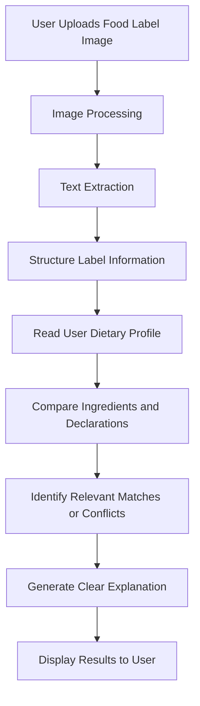

LabelLens AI
### Understand Your Food Label. Make Informed Choices.

**LabelLens AI** is an AI-powered food label analysis application designed to help users understand packaged-food labels by extracting ingredient information, interpreting nutritional values, identifying allergen declarations, and comparing visible label information with user-provided dietary preferences or restrictions.

Instead of struggling with complicated ingredient lists and nutrition tables, users can upload a label image and receive clear, easy-to-understand information to support more informed food choices.

---

Problem Statement

Packaged-food labels contain important information about ingredients, nutritional values, allergens, and dietary suitability. However, this information can be difficult to interpret quickly, especially for users who need to check specific dietary preferences or restrictions.

LabelLens AI aims to simplify this process by converting label information into understandable insights and highlighting potential matches or conflicts with a user's profile.

Our Solution

LabelLens AI combines image processing, text extraction, and intelligent analysis to make packaged-food labels easier to understand.

The application processes an uploaded food-label image, structures the information it can extract, and compares relevant details with the user's stated preferences or restrictions.

Key Features

- 📸 **Food Label Image Upload** — Upload a photograph of a packaged-food label for analysis.
- 🔎 **Text Extraction** — Extract visible text from ingredient lists, nutrition tables, and allergen declarations.
- 🧾 **Structured Label Information** — Organize extracted details into readable sections.
- 🥗 **Dietary Profile Matching** — Compare label information against user-provided dietary preferences and restrictions.
- ⚠️ **Potential Conflict Detection** — Highlight relevant ingredients or declarations that may conflict with the user's profile.
- 💬 **Easy-to-Understand Explanations** — Present extracted information in a more accessible format.
- 🔍 **Transparent Results** — Distinguish information explicitly visible on the label from information that is uncertain or could not be verified.

*Feature availability depends on the current implementation. Results should be verified against the original packaging.*

System Workflow



Technology Stack

| Component | Technology |
|---|---|
| Frontend | JavaScript and the project's frontend framework |
| Backend | Node.js |
| Backend Framework | Express.js, if configured in the project |
| Database | MongoDB, if configured |
| AI / Text Extraction | Based on the configured OCR and AI services |
| API Testing | Postman |
| Version Control | Git and GitHub |

> Update this table to reflect the exact libraries, AI models, database, and frontend framework used in your implementation.

Project Architecture

LabelLens AI follows a client-server architecture.

1. **Frontend:** Provides the interface for uploading label images and entering dietary preferences.
2. **Backend API:** Receives requests, coordinates processing, and returns analysis results.
3. **Text Extraction Layer:** Extracts readable information from the uploaded image using the configured OCR solution.
4. **Analysis Layer:** Organizes extracted information and compares it with the user's dietary profile.
5. **Database:** Stores relevant application data if database integration is enabled.
6. **Results Interface:** Presents extracted information, potential conflicts, and explanations to the user.

Getting Started

Follow these instructions to set up the project locally.

### Prerequisites

Install the following tools:

- [Node.js](https://nodejs.org/)
- npm, included with Node.js
- [Git](https://git-scm.com/)
- [MongoDB](https://www.mongodb.com/) if required by your backend
- Any additional API credentials required by the configured AI or OCR service

### 1. Clone the Repository

```bash
git clone <YOUR_GITHUB_REPOSITORY_URL>
cd LabelLens-AI-FOURLEAD
```

Replace the placeholder with your actual GitHub repository URL.

### 2. Set Up the Backend

Open a terminal and navigate to the backend directory:

```bash
cd backend
npm install
```

Create a `.env` file using the environment variables required by your project. For example:

```env
PORT=5000
MONGODB_URI=your_mongodb_connection_string
```

Add other variables only if they are required by your application. Never commit API keys, database credentials, or other secrets to GitHub.

### 3. Start the Backend

```bash
npm run dev
```

This command assumes that your backend's `package.json` defines a `dev` script. If the project uses a different script, use the one configured in that file.

### 4. Start the Frontend

Open a **new terminal** and navigate to the frontend directory:

```bash
cd frontend
npm install
npm run dev
```

Adjust the directory name and commands to match your actual frontend setup.

### 5. Open the Application

Use the local URL printed in the frontend terminal, commonly something like:

```text
http://localhost:5173
```

The exact URL depends on your frontend configuration.

## 🧪 Testing

The application can be tested using the following scenarios:

- Upload a clear photograph of a food label.
- Verify whether extracted text matches the original label.
- Check how missing or unreadable text is handled.
- Enter different dietary preferences and restrictions.
- Verify whether relevant matches and potential conflicts are identified correctly.
- Test invalid image uploads and backend error handling.
- Use Postman to test backend API endpoints where applicable.

Privacy and Safety

- Avoid uploading unnecessary personal information.
- Keep API credentials and environment variables out of public repositories.
- Treat extracted text as potentially incomplete or inaccurate.
- Verify ingredient and allergen information against the original packaging.
- Do not treat automated analysis as a substitute for professional medical advice, particularly for serious food allergies or medical dietary requirements.

Future Scope

Potential enhancements include:

- 🌐 Multilingual label explanations.
- 📊 More detailed nutritional analysis.
- 📷 Improved OCR for low-quality, angled, or multilingual label images.
- 👤 Saved dietary profiles and preferences.
- 📱 A mobile-friendly interface.
- 🛒 Product comparison based on user-defined criteria.
- ♿ Accessibility improvements for users with different needs.

These are proposed improvements for future versions.

## Accounts and personalized label checks

The API uses the existing MongoDB database. User documents now include an optional `dietaryProfile` object containing declared allergens, dietary preferences, custom restrictions, ingredients to avoid, and notes. Mongoose applies empty defaults for existing accounts, so this additive schema change needs no destructive migration.

Authentication uses a one-hour JWT in an HttpOnly cookie. The browser keeps only the CSRF value in memory and sends it with profile updates and uploads. Do not store session tokens in browser storage. In production, serve the API over HTTPS, set `NODE_ENV=production`, configure `COOKIE_SAME_SITE=none` for a separately hosted frontend, and set `CORS_ORIGINS` to the exact frontend origins.

The upload route is `POST /api/upload`. It requires the signed-in user's cookie and `X-CSRF-Token`; it loads that account's saved profile from MongoDB rather than accepting profile data from the upload. Tesseract OCR is used for extraction. OCR matching is advisory and can be incomplete; no match is not a safety guarantee. No external AI API key is used by the current integration.

Create `Backend/.env` from `.env.example`, set a unique `JWT_SECRET` of at least 32 characters and a reachable `MONGO_URI`, then run `npm run dev` from `Backend`. Run `npm run dev` from `Frontend/frontend` in a second terminal. Set `VITE_API_BASE_URL` to the backend origin for a separately hosted API; otherwise Vite proxies `/api` to port 5001.
